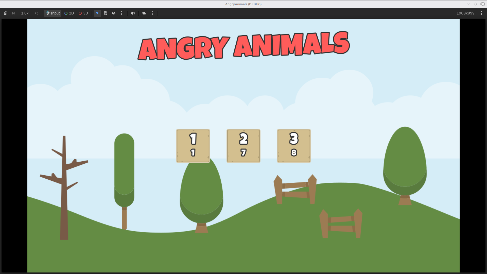
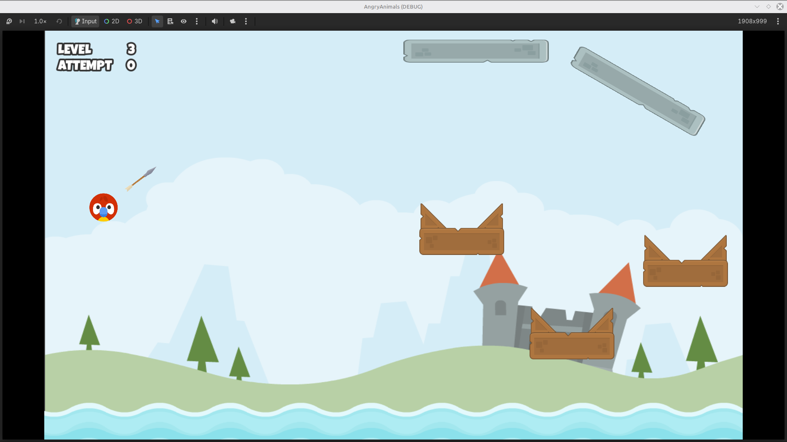

# angry-animals
A recreation of Angry Birds in the Godot Engine. Made in accordance with the course: "Jumpstart to 2D Game Development: Godot 4 for Beginners".

# Skills Learned
- Basic introduction to creating UI elements
- Collision interactions with Rigid2D Physics
- Using forces and impulses in manipulating character bodies
- Scene management and transitions
- Score saving using file reading and writing

# Challenges Encountered
- Multi-object communication
- Making variables persist between different scenes

# Solutions to Challenges
- Establishment of a Central Signal Hub for each node to pass signals to one or more nodes/scenes
- Use of Global Scope Scripts and Scenes

# In-Game Screenshots

